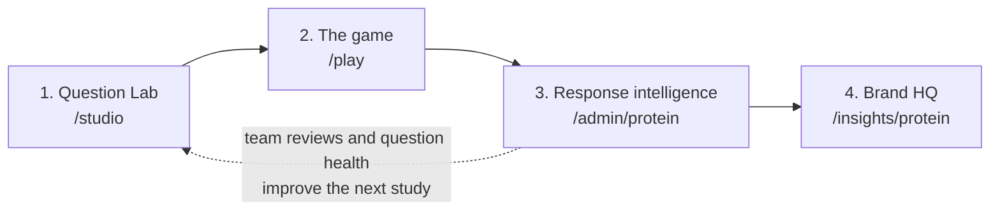

# Snack Moments 🍿

**An adaptive, behaviour-first research game with a response-intelligence engine.**

**Live demo:** https://snack-moments.vercel.app (start at [/play](https://snack-moments.vercel.app/play), then [/admin/protein](https://snack-moments.vercel.app/admin/protein))

## The problem

Brands ask research questions like this one:

> *"When choosing a snack, how important is protein content to you?" (1–5)*

Almost everyone answers 4 or 5, because protein sounds healthy. The answer tells a brand very little: it doesn't say whether people will **pay** for protein, **when** it matters, or what they'd give up for it. On top of that, some players rush or tap randomly to finish a survey, and a normal survey can't tell those answers apart from real ones.

So the problem has two parts:
1. **Ask better questions:** measure what people actually do, not what sounds good to say.
2. **Trust the answers:** spot careless or suspicious responses, without throwing away honest people whose answers simply contradict each other.

Snack Moments solves both, using protein snacks as the example category. It measures what people **trade** for protein (at which moments, at what price, against which tastes), separates *careless answers* from *honest contradictions*, and turns the contradictions into findings for the brand.

## How it works



1. **Question Lab: the AI research engine** (`/studio`). Paste a normal survey question. The engine works out what the brand needs to decide, checks the question for bias (here: social desirability and the ceiling effect), picks a format that can really measure it, and rewrites it as a behavioural question. One AI model writes and a different model reviews, so it never checks its own work. You can play the game it designs right there.
2. **The game** (`/play`). Players make real trade-offs in short snack games, about 3 minutes in total. The choice rounds adapt to each player: the next question is the one we learn the most from, and the game stops once it knows enough (4 to 10 rounds). The original 1–5 question is asked last, so we can compare what people say with what they do. Open `/play?researcher=1` to see the live quality score.
3. **Response intelligence** (`/admin/protein`). Every tap and timing is scored on the server. Careless signs (rushing, tapping the same spot, flipping on a repeat question, picking an overpriced twin) lower a session's quality score and how much it counts. Contradictions are never penalties; they become findings. Suspicious patterns across sessions (shared devices, identical answers, sudden bursts) are flagged with a reason, and a person makes the final call.
4. **Brand HQ** (`/insights/protein`). What the brand gets: how much people will pay for protein in each moment, a what-if simulator for a new product idea, the gap between what people say and what they do, and AI recommendations that cite their evidence.

| Page | What it is |
|---|---|
| `/studio` | The Question Lab: decision → bias check → format match → rewrite → independent critic → game preview. |
| `/play` | The participant game: 10 short games. Each player plays 7 (5 core + 2 bonus games picked for them) in 8 steps, mobile-first. |
| `/admin/protein` | Response intelligence: 14 dashboard sections covering every behavioural parameter, plus a drill-down for each session. |
| `/insights/protein` | Brand HQ: willingness to pay by moment and segment, a what-if demand simulator, and AI recommendations that cite their evidence. |

---

## Run it locally

You only need **Node.js 20 or newer** and git. No database or accounts to set up.

```bash
git clone https://github.com/theheetchauhan/snack-moments.git
cd snack-moments
npm install
npm run dev            # http://localhost:3000
```

With no settings, the app uses an embedded Postgres (PGlite) that saves to `./.data`, and every AI step falls back to transparent rules, so everything works offline.

To fill the dashboards, open `/admin/protein` and click **Regenerate demo data**. This creates 300 simulated sessions through the real engine and takes about 60 seconds.

```bash
npm test               # engine, rotation and new-game tests: adaptivity, parameter recovery, CUSUM, quality vs divergence, propensities, coverage
npm run typecheck
npm run playthrough    # plays one full session against the running server via the public API
npm run model:recovery # prints estimated vs true preferences for each simulated archetype
```

Optional settings: copy `.env.example` to `.env.local` and fill in what you need.
- `OPENROUTER_API_KEY` turns on the AI features (get a key at openrouter.ai). Without it, every AI step falls back to transparent rules.
- `DATABASE_URL` points at any Postgres instead of the embedded one. Tables are created automatically on first run.

## Deployment

The live version runs on **Vercel** (free Hobby plan) with a free **Neon** Postgres database. To deploy your own copy: import the repo in Vercel, add a Neon database from Vercel's Storage tab (this sets `DATABASE_URL`), optionally add `OPENROUTER_API_KEY` and `IP_SALT` as environment variables, and deploy. Then open `/admin/protein` and click **Regenerate demo data** once.

---

## The games (what each one measures)

Every game is chosen through a **construct-first registry** (`lib/registry/formats.ts`). A format is used because it can *measure* the construct, not because it looks fun. Each one builds on a common gamified-research mechanic and changes how it measures.

🎲 = bonus game. Each player gets 1 of the two 🎲 games before the rounds and 1 of the three 🎲 games after them (see *Smart rotation* below).

| # | Game | Measures | Timing allowed? | What makes it smarter than the plain mechanic |
|---|---|---|---|---|
| 1 | **Label Detective** (memory) | What gets noticed on a pack | yes | Runs **first**, before anything mentions protein, so it captures unprompted attention to price vs protein. |
| 2 | **Gut Check** (swipe) | Gut appeal | yes, on purpose | Compared with considered choices later, which gives a gut-vs-considered gap. |
| 3 🎲 | **Peek & Pick** (process tracing) | Attention priority | no | Values are hidden and you get 4 peeks. *What you look at first* is your real priority (Mouselab-style). Hidden values are only revealed by the server. |
| 3 🎲 | **My Snack Week** (frequency map) | How often each moment happens | no | The whole-week total is asked **before** the moment-by-moment map, so it doubles as a consistency probe. Frequency × ₹/g turns preferences into weekly volume in the brand simulator. |
| 4 | **Snack Moments / Showdown** (adaptive choice, 3-card and duel) | The trade-off | **no timer** | Each item is chosen to maximise expected information gain. Positions are shuffled, framing is randomised, and probes are built in. 4–10 rounds, stopping once the model is confident. |
| 5 🎲 | **Bid It** (BDM auction) | Direct willingness to pay | no | Becker–DeGroot–Marschak: bidding your true value is the best strategy. The bids are checked against the choice model. |
| 5 🎲 | **Stock the Shelf** + budget squeeze | Priorities under constraint | no | Prices start near *this player's* indifference point, then the budget drops. What gets cut first shows real staples. |
| 5 🎲 | **Build-a-Bar** (design + cost squeeze) | Ideal-product priorities | no | 10 recipe points buy concrete levels (grams, ₹) with a cap of 4 each, then a squeeze removes 3. Compared with the player's own choices, it gives a **design-vs-choice gap** (H10), which is a finding, not a penalty. |
| 6 | **Guess the Crowd** + bonus round | Projective / self-vs-others | no | Points reward *prediction accuracy*, never your own answer. Paired with your choices, it gives a desirability index. |
| 7 | Reality check → **1–5 rating, asked last** → diagnostic follow-up | Say vs do | no | The original question comes last so it can't influence the choices. The follow-up asks about *your* biggest contradiction. |

### Smart rotation of bonus games (`lib/adaptive/rotation.ts`)
This is planned missingness with judgment. Each player plays 2 of the 5 bonus games, so sessions stay short while every game still gets data.
- **Value for this player:** a score built from what the engine already knows: Label Detective recall, Gut Check speed and protein appeal, segment, posterior uncertainty, driver profile and the CUSUM rushing signal. Every score comes with human-readable reasons.
- **Coverage:** games below their target share get a boost, so no game ends up played by only one kind of player.
- **Sampling with a floor:** softmax over the scores, mixed with a 20% uniform floor. Picking 1-of-2 or 2-of-3 (by sampling the game to *drop*) gives **exact inclusion probabilities**, which are stored per session.
- **Unbiased analysis:** the dashboard re-weights optional-game results by 1/propensity (Hájek estimator with sandwich CIs). The *Game rotation* tab shows naive vs weighted estimates side by side, and proves the judgment works (e.g. which driver profiles got which games).
- Every bonus game is worth the same progress points, so the rotation never changes how many points a player can earn.

**Rewards** (`lib/session/engine.ts`) cover progress points, Snack Pass levels, one random mystery gift (after Gut Check), skill bonuses (memory, crowd prediction, bonus round), a "thoughtful player" bonus and badges.
*Integrity rule: points never depend on what anyone chooses in a preference game.*

---

## The intelligence

### Research engine (Part A)
- **Per-player Bayesian choice model** (`lib/model/choice.ts`). This is a multinomial logit over price, protein in functional moments, protein in craving moments, and taste, approximated with 2,000 particles. It produces each player's **₹ per gram of protein, per context**, with intervals, plus a driver profile.
- **Adaptive selection** (`lib/adaptive/selector.ts`). Each round scores candidate items by expected information gain minus a cost for repetition and context imbalance, then samples with a softmax, so the whole item bank gets exposure. It stops at 4–10 items.
- **CUSUM anomaly accumulator.** Suspicious evidence (rushing, repeated positions, surprising picks) adds up across rounds. When it crosses a threshold, a repeat or dominated **probe is injected on the next item**.
- **Randomised experiments, assigned on the server:**
  - health vs taste framing;
  - low vs high anchor on the first item;
  - mystery-gift size, which is random and so gives a free test of how reward size affects effort.
- **Contradictions are findings** (`lib/contradictions/detect.ts`). The strongest gap gets competing explanations and one diagnostic follow-up.

### Response intelligence (Part B)
- **One universal raw event stream** (`lib/events/tracker.ts`). Events are batched and sent with `sendBeacon` when the page is hidden. Nothing is scored on the device.
- **Expected-time model** (`lib/timing/expected.ts`). Expected time = reading load + number of options + how close the choice is for this player. We score the *residual*, not fixed cut-offs.
- **Two signal families** (`lib/scoring/signals.ts`):
  - **Noise.** These are the only signals that lower quality: speed vs expected, position bias, rhythm (weak), repeat flips weighted by the model's confidence, dominated picks, monotonicity, own-model fit vs chance, quick-game speed and open-text checks. A session goes **red only when at least 2 independent signals fire.** No one is auto-banned: amber sessions are down-weighted and red ones go to review.
  - **Divergence.** These are insights, never penalties: say–do, gut vs considered, bid vs model, choice vs shelf, self vs crowd, peeks.
- **Across sessions:** shared devices, identical answer signatures, hourly bursts, k-means and PCA clusters with outliers, and a Bayesian trust score for each participant.
- **Evidence board** (`lib/insights/evidence.ts`). It holds 11 pre-stated hypotheses, each with a 95% confidence interval (H10 and H11 are propensity-weighted). **Statistics decide the status; the AI only narrates.**

### AI (OpenRouter, multiple model families)
- **Studio:** a writer model drafts, and a critic **from a different model family** scores the draft against a bias rubric. The format can only be picked from the registry.
- **Reviewer explanations** for sessions, **open-text authenticity checks**, and **brand recommendations that must cite hypothesis ids**.
- **Guardrails:**
  - only aggregated or anonymised data is sent to the model;
  - outputs are validated against Zod schemas;
  - results are cached;
  - every AI feature has a rule-based fallback.

---

## Architecture

Open `docs/architecture.excalidraw` and `docs/part-b-framework.excalidraw` at [excalidraw.com](https://excalidraw.com) (File → Open).

```
app/            play · admin/[studyId] (+ session drill-down) · insights/[studyId] · studio · api/*
components/play/games/      one file per game (LabelDetective, GutCheck, PeekAndPick, MySnackWeek, SnackMoments,
                            BidIt, StockTheShelf, BuildABar, GuessTheCrowd, BonusRound)
components/play/questions/  the closing questions: RealityCheck, StatedRating (the 1–5, asked last), FollowupQuestion
components/play/            SnackPass (levels), RewardPopups, ResultsCard, ResearcherPanel, types
components/admin · components/insights   dashboard sections and charts
lib/model       Bayesian choice model (particles), model-implied price
lib/adaptive    information-gain selector, CUSUM, stopping rule, bonus-game rotation (value + coverage + propensity)
lib/timing      expected-time model
lib/scoring     noise vs divergence signals, quality / engagement scores
lib/contradictions, lib/insights (evidence board), lib/registry (formats)
lib/session     engine (pure state machine) · repo (DB) · service (API glue)
lib/simulate    labelled synthetic archetypes for demo data and tests
lib/ai          OpenRouter client, studio pipeline, explanations, recommendations
lib/db          Drizzle schema; PGlite locally, Neon Postgres in production
```

The **session engine is a pure state machine**: the API routes and the simulator both run the exact same code. All scoring is **server-side and versioned** (`quality-v1.3`).

---

## Honest limitations
- **Demo data is simulated.** Dashboards are labelled with the simulated share, and they show how the system *behaves*, not evidence about consumers. Real pilot data is the final judge.
- **Willingness to pay is hypothetical** in-game. Real price effects need a field test, for example a quick-commerce A/B test. Paying Bid It out in real vouchers would make it incentive-compatible.
- **Short sessions shrink estimates towards the prior.** On simulated archetypes, driver profiles are recovered correctly about 60% of the time after about 7 adaptive items (chance is 25%). Longer studies, or pooling across players (hierarchical Bayes), would improve this.
- **The local DB (PGlite) is single-process.** Use `DATABASE_URL` for deployment.
